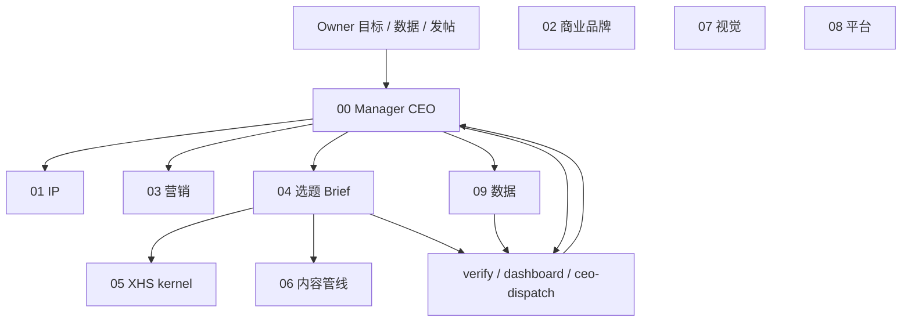

# 新 Agent 接手 · 当前程序状态与指挥手册

> **更新：** 2026-10-17（对齐 Owner 成功目标 · 认知期 · CEO/Manager workflow 闭环）  
> **验证：** `bash scripts/verify-handoff.sh`（含本文件检查）· `bash scripts/verify-agent-takeover.sh`  
> **一页纸：** [HANDOFF-SOP.md](HANDOFF-SOP.md) · **存储策略：** [HANDOFF-COMPLETENESS.md](HANDOFF-COMPLETENESS.md)

---

## 0. 新机器 / 新 Agent：先读什么、先跑什么

### 新机口令（Owner 在新 Cursor 会话里说）

```text
danying-brand-agent
```

Agent **Must** 按 [.cursor/rules/danying-brand-agent-bootstrap.mdc](../.cursor/rules/danying-brand-agent-bootstrap.mdc) 执行：**读** [HANDOFF-MD-MANIFEST.md](HANDOFF-MD-MANIFEST.md) 所列 MD → 跑 `verify-agent-takeover` + `manager-autopilot` → 汇报 CEO 派活块。**不**依赖本对话或旧 chat 历史。

**Owner 给任何「写 / 做 / Brief / 选题 / 运营」目标时，你 = 00 Manager** → [agents/00-manager/AUTO-WORKFLOW.md](../agents/00-manager/AUTO-WORKFLOW.md)。

| 顺序 | 动作 |
|------|------|
| 1 | 读本文（程序状态 + 三轨 + verify） |
| 2 | [AGENTS.md](../AGENTS.md) → [rules/USER.md](../rules/USER.md) → [integration/IMPORTANT.md](../integration/IMPORTANT.md) |
| 3 | `bash scripts/ensure-venv-deps.sh` |
| 4 | `bash scripts/manager-autopilot.sh` |
| 5 | 读 `content/analytics/derived/ceo-dispatch-latest.md` 与当日 `manager-dashboard-*.md` |
| 6 | 有 Gemini key：`VERIFY_TIER=release bash scripts/verify-all.sh`（交班）；日常 CI 档见 [VERIFY-TIERS.md](VERIFY-TIERS.md) |

**Hub 换机全克隆：** Owner 说「全部克隆」→ [danying-apps 全部克隆.md](https://github.com/dymusiques/danying-apps/blob/main/全部克隆.md) → 本仓 `SETUP.md`。

---

## 1. Owner 成功目标（G-* · 指挥时不丢）

注册表：[integration/GOALS-REGISTRY.md](../integration/GOALS-REGISTRY.md) · JSON：`integration/goals/registry.json`

| 目标 | 含义（摘要） |
|------|----------------|
| **G-STRONG-LINK** | B2B 强链接 CTA（私信/合作/评估），非 vanity 流量 |
| **G-QUALITY-GROWTH** | 小红书 1700→5000→10000 **里程碑**；**仅 Owner/CSV 验证**，不进 kernel 硬断言 |
| **G-NOT-SINGLE-VERTICAL-LOCK** | 全品类可合作；**不**把账号绑成任一垂直主攻号（家居仅为曾误绑示例） |
| **G-CROSS-INDUSTRY** | 品牌合作跨行业 open |
| **G-BRIEF-ALIGNED-GATE** | Brief 须 `evaluate --brief` → **aligned: true** 才算定稿 |
| **G-ANALYTICS-EVIDENCE** | 有 CSV 才写 derived；无数据不编造 |
| **G-PLATFORM-SYNC** | gdocs/Drive/Git 读路径可靠 |
| **G-MARKETING-CAMPAIGN** | 触达/campaign 文档在 `content/marketing/` |
| **G-BUSINESS-BRAND** | 商业品牌文档在 `content/business-brand/` |
| **G-BRAND-VISUAL** | 封面块进 Brief；Canva skill |

IP 一句话：[content/personal-ip/ip-positioning-brief-2026-10-05.md](../content/personal-ip/ip-positioning-brief-2026-10-05.md)

### 1.1 Owner 架构三要求（本对话 · 已写入 Git）

| # | 要求 | 实现方式 | 文档 / 命令 |
|---|------|----------|-------------|
| **1** | **总 CEO** | Cursor 会话内 **00 Manager** 解析 Owner 目标、派活、汇总；规则自动生效 | [AUTO-WORKFLOW.md](../agents/00-manager/AUTO-WORKFLOW.md) · `.cursor/rules/danying-manager-auto.mdc` |
| **2** | **Workflow 可自动跑** | 一条命令串 Goal 验收 → 仪表盘 → 09 → CEO 派活块（**不含** App 发帖 / CSV 导入） | [AUTOPILOT.md](AUTOPILOT.md) · `bash scripts/manager-autopilot.sh` |
| **3** | **每步有 Manager，检细步再交 CEO** | **01–09** 各角色 = 部门 Manager；每步读 `INTEGRATION-PROMPT.md` → 产出 → **verify/evaluate PASS** → 00 读 dashboard / derived / 终端 Summary 再派下一步 | [agents/README.md](../agents/README.md) · `integration/agents/a*.py`（**10×6 glue**）· `scripts/agent-shells/*.sh` · kernel **6 case**（05/02/03） |

**反馈回 CEO 的三条总线：** ① 终端 `RESULT: PASS/FAIL` ② `content/analytics/derived/manager-dashboard-*.md` ③ `ceo-dispatch-latest.md`（09→04 半自动派活）。监督环：[DANYING-BRAND-AGENT-INTEGRATION.md](DANYING-BRAND-AGENT-INTEGRATION.md) · Manager's Loop。

**刻意不做：** 多进程后台 CEO、自动发帖、自动爬小红书数据（Owner → inbox CSV）。

---

## 2. 三轨分工（① 数据 · ② 商业触达 · ③ 机制）

### 2.1 总览：Agent 已闭环 vs Owner 必做

| 轨 | Agent/仓库状态（2026-10-17） | **仅 Owner** |
|----|------------------------------|--------------|
| **① 数据** | inbox 路径、fetch、pipeline、demo、derived、CEO 派活块 **就绪** | **CSV →** `content/analytics/inbox/`（当前 **0** 个 CSV） |
| **② 商业/触达** | 认知期主文档、运营计划、队列、SWOT、**4 篇 discovery Brief 均已 aligned** | **小红书发帖**、Brief **`## 发布状态`**、15 天/4 篇快检（好/中/差）、Campaign 对外名称三选一（文档保留） |
| **③ 机制** | Goal/M4、10×6 矩阵、autopilot、仪表盘、seo-lint、CI workflow、agents+shells **就绪** | **无阻塞**；可选：git commit 定稿、Cursor 15 天 Automation、Release verify 交班跑法 |

**②③ 不包含 ① 的数据输入**；无 CSV 仍可运营（后台肉眼 + OPERATING-PLAN 暂定阈值）。

### 2.2 ② 商业触达 · 当前交付物

| 文件 | 作用 |
|------|------|
| [content/marketing/2026-10-brand-discovery-phase.md](../content/marketing/2026-10-brand-discovery-phase.md) | 认知期主触达计划（非大 Campaign / 非体验季） |
| [content/marketing/discovery-phase-OPERATING-PLAN.md](../content/marketing/discovery-phase-OPERATING-PLAN.md) | 15 天快检 / 4 篇轮检 |
| [content/marketing/discovery-phase-note-queue.md](../content/marketing/discovery-phase-note-queue.md) | 深度队列 #1–#4 |
| [content/business-brand/2026-10-17-brand-positioning-swot.md](../content/business-brand/2026-10-17-brand-positioning-swot.md) | 02 SWOT/定位 |
| [content/xiaohongshu/PUBLISH-AND-DATA-CHECKLIST.md](../content/xiaohongshu/PUBLISH-AND-DATA-CHECKLIST.md) | Owner 发帖与 CSV 步骤 |

**Discovery Brief（evaluate 已通过，发布均为「待发」）：**

1. `2026-10-17-discovery-01-irreplaceability-brief.md` ← **运营优先发这篇**
2. `2026-10-17-discovery-02-narrative-not-ads-brief.md`（建议距上一篇 ≥7 天）
3. `2026-10-17-discovery-03-professional-trust-brief.md`
4. `2026-10-17-discovery-04-open-close-brief.md`（可考虑置顶）

旧版「跨行业艺术体验季」大 Campaign 稿 **已不在仓**；勿复活单品类绑定叙事。

### 2.3 ③ 机制 · 架构（CEO + Manager · 会话内实现）

**不是**多进程自动 CEO；**是** Cursor 单会话内 **00 顺序扮演** 01–09，终端 verify 与 derived 文件作为「反馈总线」。



| 层 | 路径 |
|----|------|
| 指挥链 | [agents/00-manager/AUTO-WORKFLOW.md](../agents/00-manager/AUTO-WORKFLOW.md) |
| 10 角色目录 | [agents/README.md](../agents/README.md) |
| 集成胶水（每 Agent 6 case） | `integration/agents/a00_manager.py` … `a09_analytics.py` |
| 函数壳 | `scripts/agent-shells/00-manager.sh` … `09-analytics.sh` |
| Classifier / 6 test | `kernels/xiaohongshu/` · `kernels/strategic_docs/` |
| 全自动链（不含发帖/CSV） | [AUTOPILOT.md](AUTOPILOT.md) · `bash scripts/manager-autopilot.sh` |

### 2.4 Verify 分层（Gemini 6 case vs M4）

详见 [VERIFY-TIERS.md](VERIFY-TIERS.md#gemini-6-case-与-m4-分工)。

| 层级 | 命令/入口 |
|------|-----------|
| 部门 kernel **6 case** | `verify-xhs-topic.sh` · `verify-marketing-campaign.sh` · `verify-business-brand.sh` |
| Agent 矩阵 **10×6 glue** | `bash scripts/verify-agent-matrix.sh`（**不**在矩阵内批量烧 Gemini API） |
| **M4** 按 G-* | `bash scripts/verify-goals.sh` |
| 交班 / Release | `VERIFY_TIER=release bash scripts/verify-all.sh` |
| 单 Brief 定稿 | `bash scripts/manager-workflow-verify.sh content/xiaohongshu/<brief>.md` |

---

## 3. 运营快照（新 Agent 接手后第一眼）

- **下一执行动作（Owner）：** 发 discovery **#1**，回填 `## 发布状态`（已发布 + 日期 + 笔记链接）→ `bash scripts/manager-dashboard.sh`
- **15 天快检：** 自 **#1 发布日** 起算；未填发布日期则仪表盘提示「尚未记录首发发布日期」
- **派活块（09→04）：** `content/analytics/derived/ceo-dispatch-latest.md`（autopilot 自动刷新）
- **听见 Daily：** 日更，独立 skill；认知期不强制每条转化

---

## 4. 本对话闭环清单（机制 + 触达 · 已落地在 Git 工作区）

以下在 **2026-10-17 会话** 中完成，新 Agent **不依赖聊天历史**，读本文件即可：

- [x] Goal Registry + M4 `verify-goals.sh` + `verify_hooks.json`
- [x] M5 交班一页纸 `HANDOFF-SOP.md`
- [x] `manager-dashboard.sh` + 00 矩阵 case「仪表盘可跑」
- [x] `manager-autopilot.sh` + `ceo-dispatch-refresh.py` + SEO lint Brief
- [x] 认知期触达计划 + OPERATING-PLAN + 4 discovery Brief（aligned）
- [x] SWOT 商业品牌稿 + 02/03 strategic evaluate 路径
- [x] VERIFY-TIERS / AUTOPILOT 文档化 Gemini 与 M4 分工
- [ ] **Owner 运营：** 发帖 #1–#4、发布状态、CSV、快检判断
- [x] **Git 交班：** `62f5d83` 已 commit + push `main`（origin + github）；新机 **clone 即可** 拿到本文与机制

> **L1 私有：** 新机器须自行恢复 `.env`（Gemini）、`vendor/gdocs-skill/secrets/`（OAuth），见 [HANDOFF-COMPLETENESS.md](HANDOFF-COMPLETENESS.md)。

---

## 5. 验收命令（新 Agent Must 跑）

**一条命令（推荐 · 含 MD 锚点 + 10×6 + M4 + Gemini 6 + autopilot）：**

```bash
bash scripts/verify-handoff-program.sh
```

**分项：**

```bash
bash scripts/verify-agent-takeover.sh   # 本文 + MANIFEST + 口令规则
bash scripts/verify-handoff.sh
bash scripts/manager-autopilot.sh
bash scripts/verify-manager-integration.sh
# 交班 capstone：
VERIFY_TIER=release bash scripts/verify-all.sh
```

**2026-10-17 实测摘要：** goals 10/10、matrix 60/60、autopilot PASS、CI verify-all PASS；Release 下 05/02/03 Gemini 6 均 PASS；verify-all 嵌套跑时矩阵步曾偶发 FAIL，单独 matrix 重跑 PASS。

---

## 6. 索引（勿全盘 grep）

| 主题 | 路径 |
|------|------|
| 任务路由 | [integrations/index.md](../integrations/index.md) |
| 目录速查 | [rules/WORKSPACE.md](../rules/WORKSPACE.md) |
| 验收总表 | [check.md](../check.md) |
| 03→04 术语 | [MARKETING-TO-XHS-GLOSSARY.md](MARKETING-TO-XHS-GLOSSARY.md) |
| 15 天 Automation 草稿 | [content/marketing/automation/CURSOR-AUTOMATION-15D.md](../content/marketing/automation/CURSOR-AUTOMATION-15D.md) |
| 集成总览 + Manager's Loop | [DANYING-BRAND-AGENT-INTEGRATION.md](DANYING-BRAND-AGENT-INTEGRATION.md) |
| Brand IP 边界红线 | [integration/IMPORTANT.md](../integration/IMPORTANT.md) |

---

**给 Owner：** Agent 侧 workflow 已按成功目标闭环；你只需 **发帖 + CSV + 运营复盘**。新 Agent 读本文 + 跑 §5 即可接手派活。
