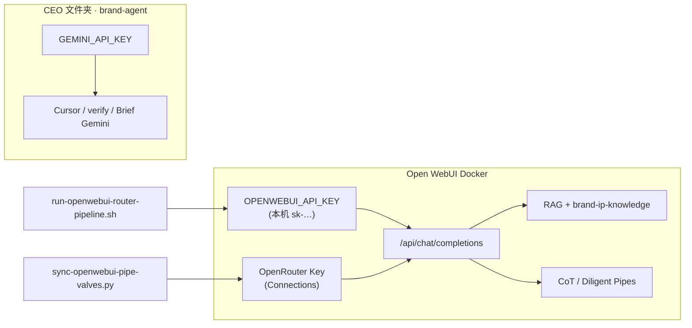

# API Key 边界（CEO Google ≠ Open WebUI OpenRouter）

## L1 任务（压缩 · Open WebUI / Cursor 顶栏）
- **Goal:** > **Owner 要求：** 电脑文件夹里为 **CEO / Cursor 流水线** 配置的 **Google（Gemini）Key**，必须与 **Open WebUI 长文 / RAG** 用的 **OpenRouter Key** 分开理解、分开存放，**禁止混用或互相覆盖**。
- **Path:** `docs/API-KEY-BOUNDARIES.md`
- **Open WebUI:** `rag_l1`
- **Cursor:** `read`

## 章节锚点
- **打不打架？——Owner 口径（无歧义 · 2026-10-29）**: **不打架。** 不是二选一，是 **两条链、两个 Key、按任务切换**：
- **术语（Agent 必读）**: | 词 | 意思 |
- **Owner 分工表（与上表等价）**: | 桶 | 做什么 | 用什么 Key |
- **三张「钥匙」对照**: | 用途 | 存哪里 | 变量 / 位置 | 调谁 |
- **数据流（简图）**: ```mermaid
- **Open WebUI 里写「Gemini」≠ 一定走 Google 直连**: | 你在 UI / 模型列表里看到的 | 实际走路 | 账单出现在 |
- **模型 ID（Open WebUI 侧 · 仍共用 OpenRouter Connections Key）**: | 场景 | 建议 env（`brand-drive-sync.env`） |
- **Agent Must / Must not**: | Must | Must not |


---

## L2 正文

# API Key 边界（CEO Google ≠ Open WebUI OpenRouter）

> **Owner 要求：** 电脑文件夹里为 **CEO / Cursor 流水线** 配置的 **Google（Gemini）Key**，必须与 **Open WebUI 长文 / RAG** 用的 **OpenRouter Key** 分开理解、分开存放，**禁止混用或互相覆盖**。

## 打不打架？——Owner 口径（无歧义 · 2026-10-29）

**不打架。** 不是二选一，是 **两条链、两个 Key、按任务切换**：

| 链 | 何时用 | 用什么 | 不用什么 |
|----|--------|--------|----------|
| **A · CEO / Cursor 本机** | 派活、Manager 编排、sub-agent、evaluate、gate、campaign 压测、Brief 改写 | **`danying-brand-agent/.env` → `GEMINI_API_KEY`（Google）** | 此阶段 **不** 为 LLM 调 OpenRouter |
| **B · Open WebUI 外包** | **仅** 长文进/出、RAG 喂入/拉出、超大上下文（CoT/Diligent + Knowledge） | **Open WebUI → Admin Connections 里的 OpenRouter Key** | 此阶段 **不** 读 CEO 的 `GEMINI_API_KEY` |

**回 CEO：** Open WebUI 只产出 **outbox 文本文件**；Cursor 里 CEO/sub-agent **继续用 Google** 读文件、改稿、evaluate——**前后串联，不是同时混用两个 Key 调同一次生成**。

**禁止误解：**

- ❌「本机 = 走 OpenRouter」—— **CEO 本机永远指 Google `.env`**；OpenRouter 只在 **调用 Open WebUI 的那几步**。
- ❌「Open WebUI 本机 API Key」= OpenRouter —— `OPENWEBUI_API_KEY` 只是进 **localhost:3000** 的门禁，**不算模型费**。
- ❌ Provider 列（Azure/Wafer）= 再绑一张卡 —— 仍是 **OpenRouter Credits 一笔账**（见下「术语」）。

## 术语（Agent 必读）

| 词 | 意思 |
|----|------|
| **model slug** | Open WebUI / OpenRouter 的 **模型 ID 字符串**，如 `deepseek/deepseek-v4.1-flash-1017`。写在 `brand-drive-sync.env` 的 `OPENWEBUI_RAG_MODEL` / `OPENWEBUI_PIPE_UPSTREAM_MODEL`——**只决定「用 OpenRouter 池里哪一个模型」**，不改变 CEO 用 Google。 |
| **OpenRouter Connection** | Open WebUI **Admin → Connections**：`https://openrouter.ai/api/v1` + **你的 OpenRouter API Key** + Enable。**长文/RAG 的 LLM 计费只走这一条**（除非你再启用别的 Connection）。 |
| **Provider（Activity 列）** | OpenRouter **内部**选的上游机房名；**不是** Open WebUI 里要选的选项，**也不是你另配的 Key**。 |

当前长文/RAG 用的 slug 以 **`RAG/RAG/scripts/brand-drive-sync.env`** 为准（与 Connections 同配即可）。

## Owner 分工表（与上表等价）

| 桶 | 做什么 | 用什么 Key |
|----|--------|------------|
| **A · Cursor / CEO / sub-agent** | **danying-brand-agent** 派活 → 00 Manager → verify/evaluate/campaign | **`GEMINI_API_KEY`（Google）** |
| **B · Open WebUI** | 长文、RAG、Knowledge；→ Desktop **outbox** → CEO 当 intake | **Connections → OpenRouter** + 上述 **model slug** |

**Router `SKIP`：** 全程 **只用 Google**，**不启动** 链 B。

**intake 回 CEO：** 链 B 已结束（outbox 已生成）；链 A 用 Google 接手——**Key 不混**。

## 三张「钥匙」对照

| 用途 | 存哪里 | 变量 / 位置 | 调谁 |
|------|--------|----------------|------|
| **CEO · Gemini 直连** | `danying-brand-agent/.env`（gitignore） | `GEMINI_API_KEY` · 可选 `GEMINI_MODEL` | Google AI Studio → Agent 03、Brief、verify shell、adversarial 等（`kernels/xiaohongshu/config/gemini_config.py`） |
| **CEO · Google 文档/Drive** | `vendor/gdocs-skill/secrets/` | OAuth `credentials.json` + `token.json` | gdocs CLI · **不是** Chat API Key |
| **Open WebUI · 本机 API** | `RAG/RAG/scripts/brand-drive-sync.env`（gitignore） | `OPENWEBUI_API_KEY` | 只认证 `http://127.0.0.1:3000` 的 `/api/...`（Router 脚本用） |
| **Open WebUI · 上游 LLM（OpenRouter 等）** | **Open WebUI 容器内** Admin → Connections | SQLite `openai.api_keys` / `openai.api_base_urls` | RAG 聊天、Pipe（CoT/Diligent）真正计费的厂商 Key |

**Router / Pipe 脚本不会读取 `GEMINI_API_KEY`。**  
**CEO 脚本不会读取 Open WebUI 里的 OpenRouter Key。**

## 数据流（简图）



## Open WebUI 里写「Gemini」≠ 一定走 Google 直连

| 你在 UI / 模型列表里看到的 | 实际走路 | 账单出现在 |
|---------------------------|----------|------------|
| `google/gemini-…` 或 OpenRouter 池里的 Gemini | **OpenRouter** → 再转发 Google | **OpenRouter**（Provider 可能显示 Google） |
| 裸 `gemini-…` 且 **Connections → Google 已 Enable** | **Google API**（`generativelanguage.googleapis.com`） | **Google AI / Cloud** |
| CEO 仓 `GEMINI_API_KEY` | **仅** Cursor/verify 脚本 | **Google**（与 Open WebUI 无关，除非你把同 Key 填进 OWUI Google Connection） |

**常见误解：** 在模型下拉里点一下 Gemini，以为用的是 CEO 文件夹里的 Google Key —— 只要当前启用的是 **OpenRouter 连接**，且选的是 OpenRouter 提供的 Gemini slug，**就会扣 OpenRouter 余额**，和 CEO `.env` 无关。

**「只 load 一下」：** OpenRouter Activity 里若出现 **Input/Output token 和 Cost**，那是 **真实 completion**（发消息、Router 脚本、Pipe 等），不是单纯刷新模型列表。纯拉 `/api/models` 一般不会按 token 计费。

## 模型 ID（Open WebUI 侧 · 仍共用 OpenRouter Connections Key）

| 场景 | 建议 env（`brand-drive-sync.env`） |
|------|-------------------------------------|
| Router **RAG_ONLY** | `OPENWEBUI_RAG_MODEL=<OpenRouter slug>` |
| **CoT / Diligent 长文** | `OPENWEBUI_PIPE_UPSTREAM_MODEL=<OpenRouter slug>` |
| RAG 要用 **Google 直连**（账单进 Google） | Admin 启用 **Google Connection** + Key → env 改为 OWUI 暴露的 **裸** `gemini-*` id |

`sync-openwebui-pipe-valves.py` 只从 Open WebUI **Connections** 复制 **OpenRouter 的 api_key** 到 Pipe Valves；**model** 来自 `OPENWEBUI_PIPE_UPSTREAM_MODEL`（若无则回退 `OPENWEBUI_RAG_MODEL`）。

## Agent Must / Must not

| Must | Must not |
|------|----------|
| 改 CEO Gemini → 只动 `brand-agent/.env` | 把 `GEMINI_API_KEY` 写进 `brand-drive-sync.env` |
| 改 OpenRouter 计费 Key → Open WebUI Admin → Connections，再跑 `sync-openwebui-pipe-valves.py` | 用 CEO 的 Google Key 填 Pipe Valves |
| 改本机 Open WebUI API → Admin → API Keys → `OPENWEBUI_API_KEY` | 把 OpenRouter Key 贴进 CEO `.env` 当 Gemini |

## 相关

- [OPENWEBUI-CEO-ROUTER.md](./OPENWEBUI-CEO-ROUTER.md)
- Desktop：`Open WebUI Personal IP/OPENWEBUI-RULES.md`
- [OWNER-GOOGLE-GRANT-AGENT.md](./OWNER-GOOGLE-GRANT-AGENT.md)（OAuth，非 Gemini API Key）