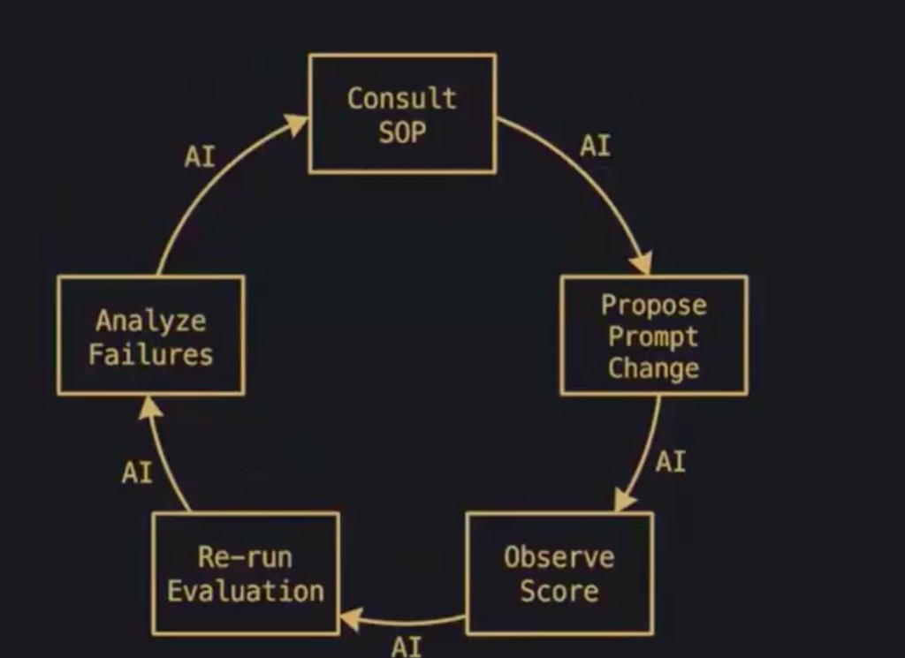

# CEO / Senior Manager 改进环 · 第二张图 ↔ 本仓审计

> **来源：** Owner 2026-10-27 分享的第二张示意图（CEO / Senior Manager 环，**顺时针 5 步，每条箭头标 AI**）。  
> **第一张图**（GM 环，箭头标 Manager）→ [MANAGER-EVAL-IMPROVEMENT-LOOP.md](./MANAGER-EVAL-IMPROVEMENT-LOOP.md)。两张图的关系见 §3。  
> **主框架：** [MANAGER-THREE-PILLARS.md](./MANAGER-THREE-PILLARS.md)（可观察性 · 可衡量基准 · 教练→SOP 资产）。  
> **落地 SOP（本文 §6 的缺口补丁）：** [../agents/00-manager/CEO-DOUBLE-ITERATION-SOP.md](../agents/00-manager/CEO-DOUBLE-ITERATION-SOP.md)  
> **状态：** 仅文档 + 清单；**未改任何脚本**，未 commit。

## 1. Owner 原图



- 仓内副本：`docs/assets/ceo-senior-manager-improvement-loop.png`
- 原始路径（Cursor 会话附件）：`/Users/danying/.cursor/projects/Users-danying-Desktop-danying-brand-agent/assets/__2026-10-27_18.41.05-10d4bcd8-d0c4-48c8-8966-93f07ec0b968.png`
- 注：文件实为 JPEG 编码（扩展名 `.png`），Markdown / 浏览器均可显示。

```text
1 Consult SOP
  →(AI) 2 Propose Prompt Change
  →(AI) 3 Observe Score
  →(AI) 4 Re-run Evaluation
  →(AI) 5 Analyze Failures
  →(AI) 回到 1 Consult SOP
```

**Owner 一句话：** CEO 的工作 = **可观察性 + 可衡量 + 知识（SOP）** → **自愈系统**（self-healing）。  
**Owner 集成要求（口语例）：** 「consult SOP.md，对当前 prompt 跑 **两轮改进迭代**」。

| 要点 | 含义 |
|------|------|
| **顺序，不并行** | 迭代 1 → **analyze** → 迭代 2（迭代 2 **基于迭代 1 的分析**）|
| **常态架构** | 这应是自动化工作流的**默认形状**；不同目标可有**额外**的并行/收集环节，但不能取代这个核心串行环 |

## 2. 与第一张图的差别（别混）

| 维度 | 图 1 · GM 环（[EVAL-LOOP](./MANAGER-EVAL-IMPROVEMENT-LOOP.md)） | 图 2 · CEO / Senior Manager 环（本文） |
|------|------------------------------------------------------------|----------------------------------------|
| 起点 | **Manual Analysis**（先分析） | **Consult SOP**（先查手册） |
| 箭头 | **Manager**（人/角色推动） | **AI**（AI 自己跑这个环） |
| 单位 | 一个 artifact（一篇 Brief） | **CEO 的 prompt / SOP / 调度逻辑本身**（元层） |
| 目标 | 把这篇稿过 gate | 让 **系统**越跑越稳（自愈） |
| 关键新增 | — | **第 1 步显式 Consult SOP**（把「知识」放进环起点）|

## 3. 嵌套关系：**CEO 编排** vs **AI 执行**

```text
Owner（目标 · gold · 发布 · 裁决）
  └─ CEO 层（00 Manager）── 编排：派活 · 门控 · 打回 · 沉淀 SOP
        │      看：observability + measurement + knowledge
        │
        └─ 图 2 环（CEO 的 prompt/SOP 改进）  ←── 箭头 = AI 执行
              Consult SOP → Propose → Observe → Re-run → Analyze → …
                    │
                    └─ 每一格内部可调用图 1 环（GM 对某 artifact 的 Manager 环）
                          Manual Analysis → Propose → Observe → Re-run → Analyze
```

| 谁 | 本仓里是什么 | 做什么 | **不**做什么 |
|----|--------------|--------|----------------|
| **CEO 编排** | `agents/00-manager/*` · `.cursor/rules/danying-manager-auto.mdc` · `CEO-DISPATCH-SOP` · dispatch 文件 · `run-ceo-*.sh` 的**选择与时机** | 选目标、定轮次上限、写 dispatch、决定是否升级 Owner、把洞见沉淀成 SOP | 不代写 GM 产出（教练式 REROUTE）；不替 Owner 发布 |
| **AI 执行环** | 同一会话里的 Agent：读 SOP → 改 prompt/Brief → 跑脚本看分 → 重跑 → 归因 | 真正转图 2 的 5 步 | 不跳过 gate；不把 FAIL 稿交 Owner |
| **脚本** | `manager-ceo-auto-gate-loop.sh` 等 | **机械**的 Observe / Re-run / 机械 Analyze（写 REROUTE） | **不会**自己 Propose prompt change（见 §5 缺口 A）|

> 单会话内 CEO 与 AI 执行者是**同一个 Agent 顺序扮演**（EVAL-LOOP §6 已说明）；文档上仍区分「编排决定」与「执行动作」，便于审计。

## 4. 图 2 五步 → 本仓映射

| 图中步骤 | 本仓落点（现状） | 脚本 / 文档 | 产物 / 证据 | 匹配度 |
|----------|------------------|-------------|-------------|--------|
| **1 Consult SOP** | AGENTS.md 要求每会话读 `rules/*`、`integrations/index.md`；Owner 给目标 → 读 `AUTO-WORKFLOW.md` · `IMPORTANT.md` · 对应 `INTEGRATION-PROMPT.md`；失败时读 `CEO-REROUTE` | [AUTO-WORKFLOW](../agents/00-manager/AUTO-WORKFLOW.md) · [CEO-DISPATCH-SOP](../agents/00-manager/CEO-DISPATCH-SOP.md) · [STANDARDS](./CEO-MANAGER-OPERATING-STANDARDS.md) · [THREE-PILLARS §3.1](./MANAGER-THREE-PILLARS.md) | 无「consult 记录」落盘 | **部分**：知识都在，但**没有单一入口名为 SOP.md**；consult 不留痕 |
| **2 Propose Prompt Change** | GM 改 Brief / classifier；同类 FAIL 第 2 次才强制固化进 `INTEGRATION-PROMPT` / challenge 节（STANDARDS §4） | `agents/<nn>-*/INTEGRATION-PROMPT.md` · `agents/_shared/BRIEF-ADVERSARIAL-CHALLENGE.md` | 改后 Brief v(N+1) / 更新后的 prompt | **弱**：多隐含在改稿里，无正式「提案」落盘（EVAL-LOOP §4.2）|
| **3 Observe Score** | evaluate / L1×6 / Gemini aligned / kernel 6 / 编辑距离 | `evaluate-xhs-brief-complete.py` · `verify-xhs-topic.sh` · `evaluate-edit-distance.py` | `verify-logs/*.json` · `RESULT: PASS/FAIL` | **强** |
| **4 Re-run Evaluation** | auto-gate 重跑；deep 多轮 | `manager-ceo-auto-gate-loop.sh`（≤3）· `run-ceo-deep-delivery-cycle.sh`（`CEO_DEEP_ROUNDS=2`）· `manager-xhs-briefs-auto-pipeline.sh` | `ceo-inbox/auto-gate-loop-<ts>.log` · `ceo-deep-delivery-<ts>.md` | **强**（脚本层）|
| **5 Analyze Failures** | FAIL → `ceo-auto-fix-brief.py` 写 REROUTE；`ceo-auto-recover-blocked.sh` 处理**进程层**故障 | `ceo-auto-fix-brief.py` · [`_template/CEO-REROUTE.md`](../content/evolution/_template/CEO-REROUTE.md) · [CEO-AUTO-RECOVER-AND-RETRY](./CEO-AUTO-RECOVER-AND-RETRY.md) | `content/evolution/04-xhs-topic-manager/<slug>/CEO-REROUTE.md`（FAIL 时才有）· `ceo-auto-recover-latest.md` | **部分**：机械归因（FAIL 清单）；**PASS 轮次不落分析**；REROUTE 无「Prompt Change 提案」节 |
| **→ 回 1** | REROUTE 里写「读 FAIL 项改…」；规则要求同会话改稿再 gate | `danying-manager-auto.mdc` 第 6 条 | — | **文字级**，非脚本强制 |

### 4.1 三支柱对图 2 的支撑（CEO = observability + measurement + knowledge）

| Owner 说的 | 支柱 | 本仓对应 |
|------------|------|----------|
| observability | ① 可观察性 | verify-logs JSON · challenge.md · redteam-pre · gate log · REROUTE · dispatch 回填 |
| measurement | ② 可衡量基准 | L1×6 · kernel 6 · fused 6-case · `RESULT: PASS` · n/3 · 编辑距离 |
| knowledge | ③ 教练→SOP | INTEGRATION-PROMPT · challenge 节 · CEO-DISPATCH-SOP · `.mdc` · STANDARDS · WORKSPACE 索引 |
| self-healing | 三者闭环 | gate FAIL → REROUTE → 改 → 重跑；中断 → `ceo-auto-recover-blocked.sh`（**这是进程自愈，非 prompt 自愈**）|

## 5. 审计：**两轮串行迭代 + 中间显式 analyze**？

### 5.1 结论（一句话）

**大体是（≈ 70%）：** 本仓核心流程**确实是串行**的「跑 → 评 → FAIL 则归因 → 重跑」，且 Brief 写稿 + evaluate 明文**禁止并行**。但 **「迭代 1 → 显式 analyze → 迭代 2 按分析改 prompt」** 在**脚本层并未成立**，只在**会话规则层**成立；`run-ceo-deep-delivery-cycle` 的 2 轮更像**两遍重跑**，轮间没有「读上一轮分析」的步骤。

### 5.2 逐机制核对

| 机制 | 串行？ | 轮间有显式 analyze？ | 下一轮是否基于上一轮分析？ | 备注 |
|------|--------|---------------------|---------------------------|------|
| **`manager-ceo-auto-gate-loop.sh`**（max 3） | ✅ `while round≤MAX` 顺序 | ⚠️ **机械**：FAIL 后调用 `ceo-auto-fix-brief.py`（读 verify-logs JSON → 列 FAIL 项 → 写 `CEO-REROUTE.md`） | ❌ **脚本内不改 Brief / prompt**：round 2 只是 **重新**跑 redteam + adversarial + evaluate。REROUTE 是写给 AI/GM 读的，**脚本自己不读** | 单次调用会**连跑完** 3 轮；若中途无人改稿，round 2/3 多半同样 FAIL。`ceo-auto-fix-brief` 内还会**再跑一次** ensure-redteam + adversarial（轮内重复，不影响串行）|
| **会话规则**（`danying-manager-auto.mdc` 4–6 · BRIEF-AUTO-GATE-PIPELINE） | ✅ | ✅ 要求「读 `CEO-REROUTE` → 改稿 → 再 auto-gate-loop（≤3）」 | ✅ **在规则层** | 依赖 Agent 自觉；**无脚本强制**；且要想让 AI 真插进轮间，需 `--max-rounds 1` 分次调用（见 SOP）|
| **`run-ceo-deep-delivery-cycle.sh`**（`CEO_DEEP_ROUNDS=2`） | ✅ `deep` 顺序：C→D→E 完 round 1 再 round 2；D 内 per-brief 的 `for` 也是串行 | ❌ 轮间**无** analyze 步；E 步只是刷新 adversarial + Owner HTML | ❌ round 2 不读 round 1 的 REROUTE/分析；两轮命令相同，**幂等重跑**除非 Agent 在两轮间手改 | 这是「**深筛/交付**」目标的**额外**设计（Phase A 收集 + B 汇总 + G 邮件），**不是**图 2 的 prompt 迭代环 |
| **`manager-xhs-briefs-auto-pipeline.sh`** | ✅ 串行 for | ⚠️ FAIL 时 `ceo-auto-fix-brief --round 1`（**固定 round=1**，不递增）| ❌ | 全仓单遍批量，不是迭代 |
| **`ceo-auto-recover-blocked.sh`** | — | ⚠️ 诊断**进程/锁/日志**（非内容质量）| 重试同一命令 | 自愈的是**运行环境**，不是 prompt |
| **`run-ceo-ip-all-agents-campaign.sh`**（01–12） | 顺序为主 | — | — | 与 deep 可并行（lock / `SKIP_GEMINI`）：**不同目标的额外并行**，OK |

### 5.3 「并行」在哪里出现（合规性）

| 并行点 | 是否违反 Owner「迭代必须串行」 | 说明 |
|--------|-------------------------------|------|
| deep-delivery 与 campaign **同时跑**（`/tmp/ceo-deep-delivery.lock` + `SKIP_GEMINI`）| **否**（不同目标；Owner 允许 extras）| 但应记入「额外/并行」，不是图 2 环 |
| Task 并行 subagent 做**调研** | **否** | [AUTO-WORKFLOW](../agents/00-manager/AUTO-WORKFLOW.md)：Brief 写稿与 evaluate 仍步 2→3 顺序 |
| 对**同一 prompt** 并行跑 2 个改进分支再选 | **本仓无** | 若将来要做，须单独标「并行实验」，不得冒充「迭代 2」|

### 5.4 缺口清单（诚实）

| # | 缺口 | 影响 | 处置 |
|---|------|------|------|
| **A** | **脚本层无 Propose Prompt Change**：auto-gate 的 round 2/3 不改 Brief | 「两轮迭代」被执行成「两遍重跑」| **本次不改脚本**；SOP 规定用 `--max-rounds 1` 分次调用，**AI 在轮间改稿/改 prompt**（见 [CEO-DOUBLE-ITERATION-SOP](../agents/00-manager/CEO-DOUBLE-ITERATION-SOP.md)）|
| **B** | **deep-delivery 的 2 轮轮间无 analyze 步** | 第 2 轮不基于第 1 轮分析 | SOP 要求：想要「迭代」语义时，deep 轮间由 AI 读 REROUTE 并写 `ITERATION-LOG`；或把 `CEO_DEEP_ROUNDS` 视为**复验**而非迭代 |
| **C** | **Consult SOP 无单一文件名**（Owner 说 `SOP.md`）| 口令「consult SOP.md」无明确指向 | 新增 **`agents/00-manager/CEO-DOUBLE-ITERATION-SOP.md`** 作为「SOP.md」入口（内部**列出**必读栈，不复制内容）|
| **D** | **Consult 不留痕**；PASS 轮不落分析 | 观察性不足（THREE-PILLARS §1 已记）| SOP 规定迭代日志模板（`ITERATION-LOG.md`，**文档约定**，未强制）|
| **E** | **REROUTE 无「Prompt Change 提案」节**（EVAL-LOOP §4.2 / PILLARS §3.2 已提）| Propose 步不显式 | 本次**仅在 SOP 里给提案格式**；改模板 / 脚本**待 Owner 点头** |
| **F** | **`ceo-auto-fix-brief.py` 在 pipeline 里固定 `--round 1`** | n/3 记录不准 | 记录，暂不改 |
| **G** | 只有同类 FAIL 第 2 次才强制沉淀 SOP；无脚本检查 | 「自愈」靠自觉 | 同 E |

### 5.5 「是否基本这样跑？」判定表

| Owner 判断点 | 是/否 | 依据 |
|--------------|-------|------|
| 迭代之间是**串行** | ✅ 是 | 脚本 `while`/`for` 顺序；规则禁并行写稿 |
| 有**重跑评估**并看分 | ✅ 是 | gate loop / deep |
| FAIL 后有**归因落盘** | ⚠️ 部分 | 仅 FAIL 才写 REROUTE，机械清单 |
| 迭代 2 **基于**迭代 1 分析 | ⚠️ 规则层是，脚本层否 | §5.2 |
| 起点 **Consult SOP** 显式 | ⚠️ 否（隐含）| 无单一入口、无留痕 → 用 SOP 文件补 |
| 有 **Propose Prompt Change** 一步 | ⚠️ 弱 | 缺口 A/E |
| 允许 extras（收集、邮件、全员 campaign）| ✅ 是 | deep Phase A/B/F/G · campaign |

## 6. 推荐的「正常工作流」写法（Owner 口令 → 本仓动作）

Owner 口语：**「consult SOP，对当前 prompt/Brief 跑两轮改进迭代」** →

1. **Consult**：读 [CEO-DOUBLE-ITERATION-SOP.md](../agents/00-manager/CEO-DOUBLE-ITERATION-SOP.md) §1 必读栈。  
2. **Iter 1**：Propose（写提案 + 改稿/改 prompt）→ `bash scripts/manager-ceo-auto-gate-loop.sh --brief … --max-rounds 1` → Observe。  
3. **Analyze**（**必须落盘**，哪怕 PASS）：写 `ITERATION-LOG` 的「迭代 1 分析」。  
4. **Iter 2**：**只**按迭代 1 分析改 → 再 `--max-rounds 1` → Observe → 与迭代 1 对比。  
5. **收尾**：对比表 + 是否固化 SOP（同类第 2 次必须）→ 交 Owner 前跑 `manager-ceo-owner-gate.sh`。

> 如果迭代 1 已 PASS：仍可按 Owner 要求做迭代 2，但目标改为「不退化 + 可观察性/质量提升」，须在分析里写明**要改进什么**；否则回报「迭代 1 已 PASS，迭代 2 无需」并请示（仅此一问）。

## 7. 诚实边界

- 本次**未改任何脚本**（`manager-ceo-auto-gate-loop.sh`、`ceo-auto-fix-brief.py`、`run-ceo-deep-delivery-cycle.sh` 均原样）。  
- 「脚本里加 `--iterations 2` + 强制 ITERATION-LOG」**未实施**——属 Owner 点头后再做的最小增量（见 SOP §6 建议）。  
- 未 commit · 未 sync Drive · 未发帖 · 未跑 gate（纯文档审计）。

## 8. 相关

[MANAGER-THREE-PILLARS](./MANAGER-THREE-PILLARS.md) · [MANAGER-EVAL-IMPROVEMENT-LOOP](./MANAGER-EVAL-IMPROVEMENT-LOOP.md) · [CEO-MANAGER-OPERATING-STANDARDS](./CEO-MANAGER-OPERATING-STANDARDS.md) · [WORKFLOW-CEO-ARCHITECTURE](./WORKFLOW-CEO-ARCHITECTURE.md) · [BRIEF-AUTO-GATE-PIPELINE](./BRIEF-AUTO-GATE-PIPELINE.md) · [CEO-AUTO-QA-LOOP](./CEO-AUTO-QA-LOOP.md) · [CEO-AUTO-RECOVER-AND-RETRY](./CEO-AUTO-RECOVER-AND-RETRY.md) · [CEO-OWNER-DEADLINE-DELIVERY](./CEO-OWNER-DEADLINE-DELIVERY.md) · [CEO-DISPATCH-SOP](../agents/00-manager/CEO-DISPATCH-SOP.md) · [AUTO-WORKFLOW](../agents/00-manager/AUTO-WORKFLOW.md)
