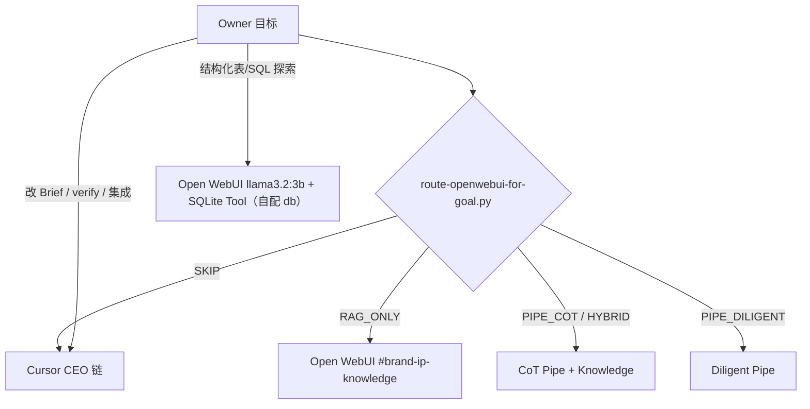

# 上下文窗口 × 私有数据 · 总路由（两课方法论 · 你的栈）

## L1 任务（压缩 · Open WebUI / Cursor 顶栏）
- **Goal:** - **Pipe 长文**：抽样核对开头/中间/结尾是否漏段。  
- **RAG**：答案必须有 Sources，spot-check 原文。  
- **SQLite Agent**：以 Tool 返回为准；SQL 可本机复跑。  
- **CEO Brief**：gate / adversarial 不变。
- **Path:** `docs/CONTEXT-WINDOW-AND-DATA-ROUTING.md`
- **Open WebUI:** `rag_l1`
- **Cursor:** `read`

## 章节锚点
- **L1 任务（压缩 · Open WebUI / Cursor 顶栏）**: - **Goal:** > **对应课程：** 输出上下文（CoT / Diligent）+ Agent 访问私有数据（Tool / RAG）— **不是** 日常必须做 WBR/events 作业。
- **章节锚点**: - **2. 任务 → 平台（Agent 必遵）**: ```mermaid
- **7. 交叉验证（Module 3 R.2）**: - **Pipe 长文**：抽样核对开头/中间/结尾是否漏段。


---

## L2 正文

# 上下文窗口 × 私有数据 · 总路由（两课方法论 · 你的栈）

> **对应课程：** 输出上下文（CoT / Diligent）+ Agent 访问私有数据（Tool / RAG）— **不是** 日常必须做 WBR/events 作业。  
> **生产数据：** Google Drive → `brand-ip-knowledge`、Git `content/`、CEO 循环。SQLite Tool **可选**，指向你自己的库。  
> **原则：** 不替换 CEO / Manager 指挥链。  
> **映射说明：** [COURSE-METHOD-TO-YOUR-STACK.md](./COURSE-METHOD-TO-YOUR-STACK.md)  
> **验收：** `bash scripts/deploy-learning-stack.sh`


## 2. 任务 → 平台（Agent 必遵）



| 任务类型 | 用 Open WebUI | 用 Cursor |
|----------|---------------|-----------|
| 长文 IP / 口播 / 3000+ 字 | **CoT**（先提纲再分节） | 压短帖、gate、进化 |
| 整份 Brief/手册 **翻译/改写** | **Diligent** | — |
| 只要事实 + Sources | **RAG_ONLY** | 交叉验证 claim |
| 结构化数据 / SQL / 图表（自有库） | **llama3.2:3b + SQLite Tool**（Valve 自配） | Python 自动化脚本 |
| Drive 新书入库 | 跑 sync 脚本后 **RAG 聊天** | MCP 读 Drive、改 mirror 配置 |
| gate / adversarial / HTML 交付 | — | **Must** |


## 4. Open WebUI 已部署清单（本机）

| 组件 | ID / 名称 | 用途 |
|------|-----------|------|
| Function | `yage_cot` | CoT 长文 |
| Function | `yage_long_context` | Diligent 长文 |
| Tool | `yage_sqlite` | 通用 SQLite；**Valve 指向你的 .db**（非课例 events） |
| Model | `local-llama3.2-3b` | 本地小模型；SQLite Tool 在聊天 **「+」按需启用** |
| Knowledge | `brand-ip-knowledge` | Drive 镜像 RAG |
| Pipe Valves 同步 | `python3 scripts/sync-openwebui-pipe-valves.py` | 从 Admin Connections 写 Valves |

配置说明：[OPENWEBUI-CEO-ROUTER.md](./OPENWEBUI-CEO-ROUTER.md) · Drive：[README-BRAND-DRIVE-KNOWLEDGE.md](../../../未命名/LLM-Ollama/RAG/RAG/README-BRAND-DRIVE-KNOWLEDGE.md)


## 6. Python 全流程自动化（课件练习 · MVP）

| 项目 | 脚本 | 做什么 |
|------|------|--------|
| Brand / CEO | `scripts/automation/brand_ip_weekly_pipeline.py` | 同步 Valves → 可选 Drive sync → 调 CEO router（dry-run 或实跑） |
| Flute Buddy | `../flute-practice-buddy/scripts/automation/practice_weekly_summary.py` | 读本机练习数据占位 + 输出周报 Markdown 模板 |

完整无人值守仍依赖现有 **shell 管道**；Python 是 **编排层**，不替换 `ceo-full-execution-pipeline.sh`。

---

## 7. 交叉验证（Module 3 R.2）

- **Pipe 长文**：抽样核对开头/中间/结尾是否漏段。  
- **RAG**：答案必须有 Sources，spot-check 原文。  
- **SQLite Agent**：以 Tool 返回为准；SQL 可本机复跑。  
- **CEO Brief**：gate / adversarial 不变。