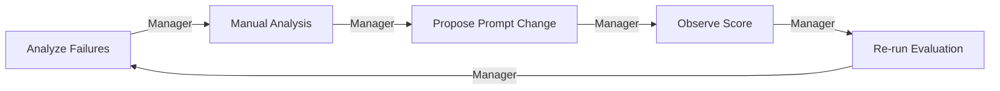

# danying-brand-agent · 集成总览

本仓库 **danying-brand-agent**（建议路径 `~/Desktop/danying-brand-agent`）= 品牌 / IP / 小红书 Agent 一体仓。  
**Agent 分角色：** `agents/` · **集成环：** `integration/` · **算法：** `kernels/` · **定稿：** `content/`。

## The Manager's Loop（集成监督环）



| 环步 | 集成层做什么 | 调用的已有函数 / 脚本 |
|------|----------------|------------------------|
| **Analyze Failures** | 收集 verify/evaluate 的 exit code、stderr、Summary | `verify-xhs-topic.sh`、`verify-xhs-content-dir.sh`、`integration/tests` |
| **Manual Analysis** | 对照 `IMPORTANT.md` + IP Brief，判断是集成问题还是核心/内容问题 | 读 Git，**不改算法** |
| **Propose Prompt Change** | 只改 **集成 prompt** / Skill / Brief，不重写 `line2` 规则 | `agents/*/INTEGRATION-PROMPT.md` |
| **Observe Score** | 看 PASS/FAIL、aligned 比例、P 层数据（若有 analytics Agent） | `evaluate-xhs-topic.py` JSON |
| **Re-run Evaluation** | 重跑 6 case（核心）+ 6 case（集成） | 见 `integration/tests/` |

## Agent 目录（分角色）

| 目录 | 角色 | 算法 / 真相源 |
|------|------|----------------|
| [agents/00-manager](agents/00-manager/) | 总 Manager · 监督环 | 无 Gemini 核心 |
| [agents/01-personal-ip](agents/01-personal-ip/) | IP & 战略 | `content/personal-ip/` |
| [agents/02-business-brand](agents/02-business-brand/) | 商业品牌 | `content/business-brand/` |
| [agents/03-marketing-strategy](agents/03-marketing-strategy/) | 营销渠道 | `content/marketing/` |
| [agents/04-xhs-topic-manager](agents/04-xhs-topic-manager/) | 小红书选题 Brief | `evaluate-xhs-topic.py` |
| [agents/05-xhs-kernel](agents/05-xhs-kernel/) | Classifier 核心 | `kernels/xiaohongshu/line2/` · **6 Gemini test** |
| [agents/06-xhs-content-pipeline](agents/06-xhs-content-pipeline/) | Brief 批量管线 | `verify-xhs-content-dir.sh` |
| [agents/07-brand-visual](agents/07-brand-visual/) | 视觉封面 | Canva / `content/visual/` |
| [agents/08-platform-integration](agents/08-platform-integration/) | gdocs/Drive/OAuth | `verify-integration.sh` |
| [agents/09-data-analytics](agents/09-data-analytics/) | 小红书数据复盘 → 下一选题 | 见该目录 `DATA-NEEDS.md` |

Cursor 仍从 `.cursor/skills/` 加载 Skill；各 Skill 已指向此处 **canonical** 集成说明。

## 集成验收（Manager 层 6 test · 不调新算法）

```bash
bash scripts/verify-manager-integration.sh
```

测的是：**无目标正文堆在集成里**，能否 **调已有函数**、读到 **IMPORTANT**、路径正确。

## 品牌 / IP 内容（Git 真相源）

`content/{personal-ip,business-brand,marketing,xiaohongshu,visual}/`
