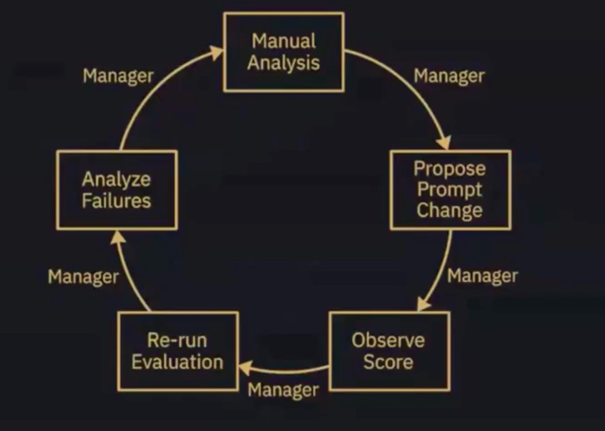

# Manager 评估改进环 · 每个 GM（01–12）的闭环对照

> **来源：** Owner 2026-10-27 分享的示意图（Manager evaluation loop，顺时针 5 步，每条箭头标 **Manager**）。  
> **结论先行：** 本仓对 GM 的流程 **基本类似** 这个环——而且 `agents/00-manager/AUTO-WORKFLOW.md` 的 *Manager's Loop* 本来就是同一个环。**更强：** 自动化 6-test + 对抗 + 机器打回；**更弱：** 「Propose Prompt Change」多数时候只是隐含在改稿里，没有被**正式落盘成一步**（见 §4）。  
> **主框架：** 本文五步环是 Owner **三支柱**的「支柱 3 执行层」→ [MANAGER-THREE-PILLARS.md](./MANAGER-THREE-PILLARS.md)（可观察性 / 可衡量基准 / 教练→SOP 资产）  
> **接手：** [AGENT-TAKEOVER](./AGENT-TAKEOVER.md) · 运营标准 [CEO-MANAGER-OPERATING-STANDARDS](./CEO-MANAGER-OPERATING-STANDARDS.md)

## 1. Owner 原图



- 仓内副本：`docs/assets/manager-eval-improvement-loop.png`
- 原始路径（Cursor 会话附件）：`/Users/danying/.cursor/projects/Users-danying-Desktop-danying-brand-agent/assets/__2026-10-27_18.38.50-1cc0629f-28d7-4eb4-a16f-6216ac5781f9.png`
- 注：文件实为 JPEG 编码（扩展名 `.png`），Markdown 预览/浏览器均可显示。

## 2. 五步（顺时针）与「Manager」箭头

```text
1 Manual Analysis
   → (Manager) 2 Propose Prompt Change
   → (Manager) 3 Observe Score
   → (Manager) 4 Re-run Evaluation
   → (Manager) 5 Analyze Failures
   → (Manager) 回到 1 Manual Analysis
```

| # | 图中步骤 | 含义（本仓口径） |
|---|----------|------------------|
| 1 | **Manual Analysis** | 读 FAIL 具体项 / 数据 / 对标，判断**为什么**差，不凭感觉重写 |
| 2 | **Propose Prompt Change** | 提出对 **集成 prompt / Brief / Skill / challenge 节** 的改动（**不改 kernel**，除非 05 专项） |
| 3 | **Observe Score** | 看分：`RESULT: PASS/FAIL` · failures 数 · 编辑距离 · aligned |
| 4 | **Re-run Evaluation** | 改完后重跑同一套 evaluate / verify / gate |
| 5 | **Analyze Failures** | 仍 FAIL 的项逐条归因 → 回到 1 |

**每条箭头 = Manager 在推动。** 仓内 `agents/00-manager/ROLE.md`：「Manager's Loop 每一步的『Manager』箭头：派活、贴报错、重跑 evaluate/verify、禁止未 aligned 定稿」。`AUTO-WORKFLOW.md` 写的顺序是 `Analyze Failures → Manual Analysis → Propose Prompt Change → Observe Score → Re-run Evaluation`（起点不同，**同一个环**）。

## 3. 总映射：图中步骤 → 仓内脚本 / 文档 / 产物（以 04 为典型 GM）

| 图中步骤 | 04 xhs-topic-manager 对应 | 脚本 / 文档 | 产物 / 证据 |
|----------|---------------------------|-------------|-------------|
| **Manual Analysis** | 写 Brief 前读 intake 栈、09 的 next-topics；写前 **redteam-pre**（2 攻击 + 驳/改）；FAIL 后读 CEO-REROUTE 的 FAIL 项 | [XHS-CONTENT-INTAKE-STACK](./XHS-CONTENT-INTAKE-STACK.md) · `ensure-redteam-pre.py` · [BRIEF-REDTEAM-PRE](../content/xiaohongshu/BRIEF-REDTEAM-PRE.md) · [STANDARDS §3 数据驱动](./CEO-MANAGER-OPERATING-STANDARDS.md) | `content/xiaohongshu/redteam/<slug>-pre.md` · `content/analytics/derived/next-topics-*.md` |
| **Propose Prompt Change** | GM 改 Brief / classifier JSON；CEO 对**同类错误第 2 次**要求固化进 `INTEGRATION-PROMPT.md` 或 challenge 节（Standards §4） | `agents/04-xhs-topic-manager/INTEGRATION-PROMPT.md` · `agents/_shared/BRIEF-ADVERSARIAL-CHALLENGE.md` · `CEO-REROUTE.md` 的「GM Must」 | 改后的 Brief `v(N+1)` / 更新后的 INTEGRATION-PROMPT（**弱：见 §4**） |
| **Observe Score** | 机器验收：redteam-pre · **重对抗** · L1×6 · Gemini evaluate · kernel 6；编辑距离（有 gold） | `run-xhs-brief-adversarial-challenge.py` · `evaluate-xhs-brief-complete.py` · `evaluate-xhs-topic.py` · `evaluate-edit-distance.py` · `verify-xhs-voice-qa.sh` | `content/xiaohongshu/verify-logs/*` · `challenge/<slug>-challenge.md` · `metrics.jsonl` · `RESULT: PASS/FAIL` |
| **Re-run Evaluation** | auto-gate-loop 自动重跑，≤3 轮 | `bash scripts/manager-ceo-auto-gate-loop.sh --brief …`（内含 ensure-redteam → adversarial → complete → `verify-xhs-topic.sh`） | `ceo-inbox/auto-gate-loop-<stamp>.log` · `RESULT: PASS auto-gate-loop round=n` |
| **Analyze Failures** | FAIL → 机械归因写 CEO-REROUTE；GM 读后改稿 | `scripts/ceo-auto-fix-brief.py` · [`_template/CEO-REROUTE.md`](../content/evolution/_template/CEO-REROUTE.md) · [CEO-AUTO-QA-LOOP](./CEO-AUTO-QA-LOOP.md) | `content/evolution/04-xhs-topic-manager/<slug>/CEO-REROUTE.md`（FAIL 时才生成） |
| **「Manager」箭头** | 00 CEO 派活 / 贴报错 / 重跑 / 禁止未 PASS 交 Owner | `manager-ceo-owner-gate.sh` · [AUTO-WORKFLOW](../agents/00-manager/AUTO-WORKFLOW.md) | 派活记录：**Owner Gate PASS/FAIL · 打回轮次 n/3 · 交 Owner：是/否** |

### 3.1 各 GM（01–12）的环落点

| GM | Manual Analysis | Propose Prompt Change | Observe Score | Re-run Evaluation | Analyze Failures |
|----|-----------------|----------------------|---------------|-------------------|------------------|
| **01** personal-ip | 读 Brief + challenge「融合/01 攻击」 | 改 Pitch / IP 红线；驳方向回 04 | `verify-agent-fused --agent 01`（A matrix）· 编辑距离 | 同命令重跑 | challenge 驳回项 |
| **02** business-brand | 读 IP Brief + 竞品/SWOT 草稿 | 改 `content/business-brand/` 稿与本岗 prompt | `lint-strategic-doc.py` · `evaluate-business-brand.py`（Gemini 6）· `verify-business-brand.sh` | `verify-agent-matrix.sh --agent 02` | lint / G-NOT-SINGLE-VERTICAL-LOCK FAIL 项 |
| **03** marketing | 读目标 + 触达假设 | 改 campaign 段 | `evaluate-marketing-campaign` · `fused 03` | `fused 03` | evaluate FAIL 项 |
| **04** xhs-topic | 见 §3 / §5 | Brief / classifier / INTEGRATION-PROMPT | L1×6 + adversarial + evaluate + kernel 6 | auto-gate-loop ≤3 轮 | CEO-REROUTE |
| **05** xhs-kernel | 读 04 进化链是否收敛 | **仅 05 专项**才改 kernel | `verify-xhs-topic.sh`（Gemini 6） | 同命令 | 6 case FAIL |
| **06** content-pipeline | 批量目录清单 | 改批量规则（卫生项） | `verify-xhs-content-dir.sh`（如 SEO 6/6） | 同命令 | H1 超长等 verify 报错 |
| **07** brand-visual | 读 brand kit | 改封面/视觉块 | `07-brand-visual.sh --check` · `fused 07` | 同命令 | kit 不一致项 |
| **08** platform | 读同步范围 | 改同步清单（不越权写 Brief） | `08-platform.sh` · `fused 08` | 同命令 | OAuth/同步报错 |
| **09** data-analytics | 读 CSV/inbox；无 CSV 标「未验证」 | 改 next-topics 口径 | `analytics-pipeline.sh` · `fused 09` | 同命令 | 口径缺失 |
| **10** artist-benchmark | baseline = gold-rubric；对标 watchlist | 改 rubric / 借鉴分规则 | `test_artist_benchmark_6.py` · `metrics.jsonl`（DB/PLD/APO/CTD） | `fused 10 --with-artifacts` | `challenge-log.md`（vanity / 编造 timeline） |
| **11** ip-daily-evaluator | 读 rollups + Brief hygiene | 改每日 X 坑清单 | `test_ip_daily_eval_6.py` · `metrics.jsonl` | `fused 11 --with-artifacts` | 缺 redteam-pre / 缺 challenge |
| **12** owner-daily-brief | 读 10/11 GM-REPORT | 改一页简报结构/口吻 | `test_owner_daily_brief_6.py` | `fused 12 --with-artifacts` | brief 结构 FAIL |

> 01–09 的统一命令入口：`bash scripts/verify-agent-fused.sh --agent NN`（A matrix glue + B 仅 04/05 挂 05 Gemini 6）；10–12 日更套件见 [`agents/_shared/SUBAGENT-DAILY-KIT.md`](../agents/_shared/SUBAGENT-DAILY-KIT.md)（Baseline → 6 Test → Challenge → Evaluator）；总表 [VERIFY-AGENT-FUSED](./VERIFY-AGENT-FUSED.md)。

## 4. 诚实差距：我们更强 / 更弱

### 4.1 更强（比示意图多出来的）

| 项 | 说明 |
|----|------|
| **自动化 6-test** | 每岗有 L1×6（10/11/12）、matrix 6 glue（01–09）、05 Gemini 6；`verify-agent-fused.sh` 一条命令跑齐 |
| **对抗层** | redteam-pre（轻）→ `run-xhs-brief-adversarial-challenge.py`（重：外部 + 对打 + FULL-DRILL）；01/04/09/11 GM 都读 challenge 节；图里没有 |
| **无人值守闭环** | `manager-ceo-auto-gate-loop.sh` 自动重跑 ≤3 轮；FAIL 不交 Owner；中断自动 `ceo-auto-recover-blocked.sh` |
| **可衡量证据** | 数字 + 路径 + `RESULT: PASS`（Standards 原则 2）；编辑距离 / `metrics.jsonl` 趋势 |
| **角色分层** | GM 自做 Collector + Evaluator + GM-REPORT；CEO 只 gate/派活/reroute（见 §6） |

### 4.2 更弱（图里强调、我们没做满）

| 缺口 | 现状 | 建议（**未实施**，待 Owner 点头） |
|------|------|-----------------------------------|
| **Propose Prompt Change 未正式成步** | `ceo-auto-fix-brief.py` 写的 REROUTE 只是机械 FAIL 清单 + 「GM Must」；GM 多数改 **Brief 正文**，而不是显式提出「改 `INTEGRATION-PROMPT.md` / challenge 节」。仅在「同类错误第 2 次」才要求固化（Standards §4），**无脚本检查** | 在 `CEO-REROUTE.md` 模板加 **「Prompt Change 提案」** 小节（改哪份 prompt · 一句 diff · 预期哪条 gate 变绿）；GM-REPORT 加「本轮是否改 prompt：是/否 + 路径」 |
| **Observe Score 对 prompt 的归因弱** | 分数是对 **稿** 打的（PASS/FAIL、编辑距离），不是对「某次 prompt 改动」打分；改 prompt 前后没有 A/B 对比记录 | `metrics.jsonl` 增加 `prompt_rev`/`change_note` 字段（待设计） |
| **Manual Analysis 部分依赖会话** | 手工归因常发生在 Agent 会话里，只有 FAIL 时才落 REROUTE；成功轮次的分析不落盘 | 每轮（含 PASS）在 GM-REPORT 写一行「本轮分析结论」 |
| **04 的 evolution 目录是懒创建** | `content/evolution/04-xhs-topic-manager/` 当前仓内**不存在**（仅 FAIL 时 `ceo-auto-fix-brief.py` 才创建）；10/11/12 日更则有 `content/evolution/<nn>-*/<date>/` | 视需要在 04 派活时预建 `<slug>/{intake,versions,reference}` |
| **01–03、07–09 的 evaluate 深度不一** | 有的岗只有 matrix glue（结构检查），没有对稿的分数环 | 对照 [GOALS-REGISTRY](../integration/GOALS-REGISTRY.md) 逐岗补 evaluate |
| **环的 Manager 箭头 = CEO 一人** | 单会话顺序扮演，CEO 与 GM 的「Manager」箭头在 Agent 脑中是同一个角色 | 见 §6：CEO 层有另一张图时再区分 |

## 5. 示例走查 · 04 xhs-topic-manager（Discovery 类 Brief）

场景：`content/xiaohongshu/2026-10-17-discovery-01-irreplaceability-brief.md` 一篇 Brief，gate 第 1 轮 FAIL。

1. **Manual Analysis**
   - 写 Brief 前已读 intake 栈 + `next-topics-*.md`，并落盘 `redteam/…-discovery-01-irreplaceability-pre.md`（2 攻击 + 驳/改）。
   - Gate FAIL 后读 `verify-logs/*` 与 `CEO-REROUTE.md` 里的 FAIL 项（例：classifier JSON 缺字段 / 缺 challenge 文件）。
2. **Propose Prompt Change**
   - GM 提出：改 Brief 的 classifier JSON / 结构（**必做**）；若同类问题第 2 次出现 → 同时在 `agents/04-xhs-topic-manager/INTEGRATION-PROMPT.md` 或 `BRIEF-ADVERSARIAL-CHALLENGE.md` 加一条检查（Standards §4）。
   - ⚠️ 目前这一步多半隐含在改稿里；**建议**写进 REROUTE 的「Prompt Change 提案」（§4.2）。
3. **Observe Score**
   ```bash
   python scripts/run-xhs-brief-adversarial-challenge.py --brief content/xiaohongshu/<file>-brief.md
   python scripts/evaluate-xhs-brief-complete.py --brief content/xiaohongshu/<file>-brief.md --skip-kernel-six
   ```
   看 `RESULT`、failures、L1-1…L1-6、evaluate aligned。
4. **Re-run Evaluation**
   ```bash
   bash scripts/manager-ceo-auto-gate-loop.sh --brief content/xiaohongshu/<file>-brief.md   # ≤3 轮
   bash scripts/manager-ceo-owner-gate.sh --brief content/xiaohongshu/<file>-brief.md        # 交 Owner 前
   ```
   期望末行 `RESULT: PASS auto-gate-loop round=n`；晚间战役实例：Discovery 01 **round 1/3** 即过（见 STANDARDS 示范案例）。
5. **Analyze Failures**（若仍 FAIL）
   - `ceo-auto-fix-brief.py` 写 `content/evolution/04-xhs-topic-manager/<slug>/CEO-REROUTE.md` → 回到 Manual Analysis；第 3 轮仍 FAIL → 才升级 Owner（附诊断）。
6. **Manager 派活记录**（每轮）：`Owner Gate PASS/FAIL · 打回轮次 n/3 · 交 Owner：是/否`。

**GM 收尾：** 更新 `GM-REPORT.md`（模板见 [IP-MANAGEMENT-HIERARCHY](./IP-MANAGEMENT-HIERARCHY.md)），含 `evaluate-edit-distance.py` 的 metrics（有 gold 时）。

## 6. 给下一张图铺垫 · CEO / Senior Manager 层与 GM 的区别

> **CEO 环（Owner 第二张图，已到）→ [CEO-SENIOR-MANAGER-IMPROVEMENT-LOOP.md](./CEO-SENIOR-MANAGER-IMPROVEMENT-LOOP.md)**（图 `docs/assets/ceo-senior-manager-improvement-loop.png` · 落地 SOP [CEO-DOUBLE-ITERATION-SOP](../agents/00-manager/CEO-DOUBLE-ITERATION-SOP.md)）。架构分层另见 [WORKFLOW-CEO-ARCHITECTURE](./WORKFLOW-CEO-ARCHITECTURE.md)。以下为现状简述。

| 维度 | 部门 GM（01–12）≈ 本文这个环 | CEO（00 Manager） |
|------|-------------------------------|-------------------|
| 主要动作 | **自己**出 v0…vN，自己 evaluate、改稿、重跑 | **派活 / 门控 / 打回 / 汇总**，不代写 GM 产出（Standards §4：教练式 REROUTE，CEO 不代笔） |
| 环的单位 | 一个 artifact（一篇 Brief、一份日更） | 跨 GM：dispatch → 收 GM-REPORT → Owner Gate → REROUTE / 交 Owner |
| 看什么分 | 本部门 6-test、编辑距离 | 全员矩阵 `RESULT: PASS`、failures 0、Gate 轮次 n/3 |
| 不做什么 | 不把 FAIL 稿交 Owner；不扩范围 | **不**绕过 GM 直接产部门 v0（除非 Owner 明确「CEO 代笔」）；不替 Owner 发布 |
| 文档 | 各 `INTEGRATION-PROMPT.md` | [CEO-DISPATCH-SOP](../agents/00-manager/CEO-DISPATCH-SOP.md) · [CEO-AUTO-QA-LOOP](./CEO-AUTO-QA-LOOP.md) · [CEO-OWNER-DEADLINE-DELIVERY](./CEO-OWNER-DEADLINE-DELIVERY.md) · [CEO-AUTO-RECOVER-AND-RETRY](./CEO-AUTO-RECOVER-AND-RETRY.md) |

### 待办占位

- [x] Owner 第二张图已到：图 `docs/assets/ceo-senior-manager-improvement-loop.png`；「CEO 环 ↔ GM 环」嵌套关系与 §4.2 缺口承接见 [CEO-SENIOR-MANAGER-IMPROVEMENT-LOOP §3 / §5.4](./CEO-SENIOR-MANAGER-IMPROVEMENT-LOOP.md)。

## 7. 相关

- [agents/README.md](../agents/README.md) · [AUTO-WORKFLOW](../agents/00-manager/AUTO-WORKFLOW.md)（Manager's Loop）
- [BRIEF-AUTO-GATE-PIPELINE](./BRIEF-AUTO-GATE-PIPELINE.md) · [BRIEF-ADVERSARIAL-CHALLENGE](../agents/_shared/BRIEF-ADVERSARIAL-CHALLENGE.md)
- [VERIFY-AGENT-FUSED](./VERIFY-AGENT-FUSED.md) · [COLLECTOR-EVALUATOR](../agents/_shared/COLLECTOR-EVALUATOR.md) · [IP-MANAGEMENT-HIERARCHY](./IP-MANAGEMENT-HIERARCHY.md)
