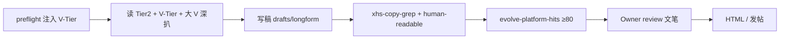

# 双线文案 workflow · FluteBuddy × 张丹瀛 IP

> **轨路由：** [`CEO-DUAL-TRACK-WORKFLOWS.md`](./CEO-DUAL-TRACK-WORKFLOWS.md)  
> **自动化清单：** [`integration/handoff/workflow-automation-manifest.json`](../integration/handoff/workflow-automation-manifest.json) · layer **`L2c_DUAL_TRACK_COPY`**

## 算不算「自动 workflow」？

**是半自动 workflow，不是 100% 无人值守。**

| 阶段 | 谁做 | 自动？ |
|------|------|--------|
| 识别 A/B 轨、注入 Must-read | `ceo-preflight-product-context.py` | ✅ |
| 战略 / 生态链 / 对标 JSON 落盘、HTML 重建弹出 | `build-owner-*-deliverable-html.py` + open 脚本 | ✅ |
| 深扒大 V、更新 benchmark JSON | Cursor Agent 会话 | ⚙️ 规则 Must，无定时爬虫 |
| 按 V-Tier 写 Brief / longform / 三平台稿 | Agent + Tier2 + V-Tier JSON | ⚙️ |
| 禁词 / 人话 / evolution 四维度 | 脚本 gate | ✅（有 Brief 时） |
| **文笔终检、是否发布** | **Owner review** | ❌ 故意保留 |

结论：**机器负责路由、对标库、门禁与 HTML；文笔到大 V 档靠 Agent 执行 V-Tier 清单；最后一步永远是 Owner 看稿。**

## 两条线共用同一套文笔标准

- **标准真源：** `docs/OWNER-COPY-V-TIER-400K-MANDATE.md` + `integration/handoff/owner-copy-v-tier-400k.json`
- **高互动滚动语料：** `integration/handoff/owner-copy-v-tier-live-corpus.json` + [`OWNER-COPY-V-TIER-LIVE-CORPUS-SOP.md`](./OWNER-COPY-V-TIER-LIVE-CORPUS-SOP.md)
- **IP 额外：** `integration/handoff/owner-ip-benchmark-creators.json`（人设 + 生态链怎么列）
- **FluteBuddy 额外：** 产品真源 `content/product/flutebuddy-ceo-snapshot.md`；文风仍走 V-Tier，勿降成功能列表

## 标准循环（有 Brief 时）



无 Brief 的战略任务：仍 Must 更新/读 V-Tier JSON；成稿时再跑完整循环。

## 命令速查

```bash
# 轨解析（含 copy must_read）
.venv/bin/python scripts/ceo-preflight-product-context.py --goal "<Owner 原话>"

# V-Tier 文件完整性
bash scripts/verify-owner-copy-v-tier-mandate.sh

# A 轨 HTML · B 轨 HTML
bash scripts/open-owner-flutebuddy-deliverable-html.sh
bash scripts/open-owner-ip-ecosystem-deliverable-html.sh
```
