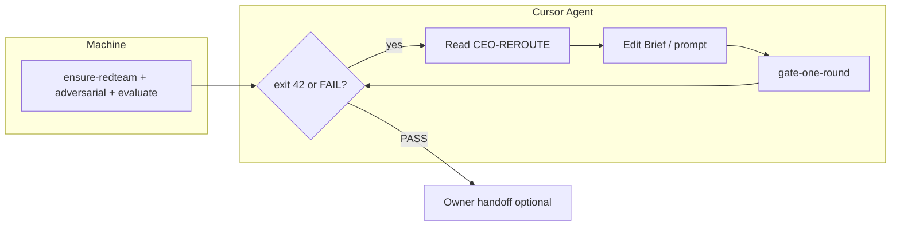

# Workflow 自动化矩阵 · AI / Owner 共用

## L1 任务（压缩 · Open WebUI / Cursor 顶栏）
- **Goal:** > **机器可读：** [integration/handoff/workflow-automation-manifest.json](../integration/handoff/workflow-automation-manifest.json)  
> **验收：** `bash scripts/verify-workflow-automation.s
- **Path:** `docs/WORKFLOW-AUTOMATION-MATRIX.md`
- **Open WebUI:** `rag_l1`
- **Cursor:** `read`

## 章节锚点
- **1. 直接回答：已经「完全自动化」了吗？**: **还没有 100%。** 本仓是 **两层自动化**：
- **2. 四象限（Agent 先读 JSON 再读本节）**
- **3. Agent 标准循环（Brief）**: ```mermaid
- **4. Owner 口语 → 动作（零 bash）**: 见 [CEO-OWNER-ONE-LINE-TRIGGERS.md](./CEO-OWNER-ONE-LINE-TRIGGERS.md) · JSON `ceo-gm-operating-manife…
- **5. 维护**: 改自动化边界时 **Must** 同步：


---

## L2 正文

# Workflow 自动化矩阵 · AI / Owner 共用

> **机器可读：** [integration/handoff/workflow-automation-manifest.json](../integration/handoff/workflow-automation-manifest.json)  
> **验收：** `bash scripts/verify-workflow-automation.sh`  
> **指挥链：** [agents/00-manager/AUTO-WORKFLOW.md](../agents/00-manager/AUTO-WORKFLOW.md) · **红线：** [integration/IMPORTANT.md](../integration/IMPORTANT.md)

## 1. 直接回答：已经「完全自动化」了吗？

**还没有 100%。** 本仓是 **两层自动化**：

| 层 | 覆盖 | 说明 |
|----|------|------|
| **机器层（无人值守）** | **≈85%** | 定时 cycle、redteam/adversarial/evaluate 批量、dispatch、recover、metrics、09 demo/CSV pipeline |
| **内容闭环（Brief 定稿）** | **≈70%** | 评估与打回 **自动**；**改稿** 必须 Cursor Agent（或 Owner）在轮间执行；脚本 **不会** 自己改 Brief 正文 |

**Owner 日常仍只有两件事（设计如此）：** 平台 **发帖** + 导出 **CSV**。Gate PASS **不**等你回复；通知 = 当日 HTML · [OWNER-DELIVERY-NOTIFY-DEFAULT.md](./OWNER-DELIVERY-NOTIFY-DEFAULT.md)。

## 2. 四象限（Agent 先读 JSON 再读本节）

### 2.1 已全自动（不必开 Cursor）

- `background-goal-evolution-cycle.sh`（09:00 · process-launcher）
- `ensure-redteam-pre` · `run-xhs-brief-adversarial-challenge` · `evaluate-xhs-brief-complete`（批量）
- `ceo-dispatch-refresh` · `manager-dashboard` · `evolution-rollups-all` · `run-daily-gm-trio`
- `ceo-auto-recover-blocked` · deep-delivery / campaign 锁协调
- `new-machine-bootstrap` · `ensure-background-goal-evolution`

### 2.2 Agent 会话内自动（规则 Must，无 Owner 口令）

- Owner 给目标任务 → **步 −1 Open WebUI Router** · [`OPENWEBUI-CEO-ROUTER.md`](./OPENWEBUI-CEO-ROUTER.md) · `run-openwebui-router-pipeline.sh` → **00 Manager** · [AUTO-WORKFLOW](../agents/00-manager/AUTO-WORKFLOW.md) · **[Owner Mandate](./OWNER-XHS-ADVERSARIAL-AND-EVOLUTION-MANDATE.md)**（Brief 类）
- 写 Brief 前 → **pitfalls MD** + 三镜头 · 写后 → **`manager-brief-evolution-until-gap.sh`** 直到 **EVOLUTION-GAP READY**（**勿问 Owner** 第 2 轮）
- 改 Brief 后 → gate + **`analyze-brief-evolution-gap.py`**；NEEDS_WORK → 读 **EVOLUTION-GAP** + **CEO-REROUTE** → **实质性改稿** → 再跑
- 「请 CEO 开始工作」→ recover + `agent-work-queue` + 最新 dispatch
- 双轮迭代 → `manager-ceo-double-iteration.sh --phase 1` → 填 **ITERATION-LOG** → `--phase 2`

### 2.3 Owner 仅（无法脚本替代）

- 小红书 / IG **发帖**（无 API）
- **CSV** 导出（涨粉证据 G-QUALITY-GROWTH）
- **Gold / 发布 / 战略裁决**；gate **3 轮仍 FAIL** 升级
- 首次 **OAuth** · Cursor **MCP Connect**
- IMPORTANT 列出的 **破坏性** 操作

### 2.4 已知缺口（诚实 · 与处置）

| # | 缺口 | 处置状态 |
|---|------|----------|
| A | Gate 多轮在无改稿时「空转」 | **已缓解：** `manager-ceo-auto-gate-loop` 检测 Brief 未变则 **exit 42**；Agent 用 `manager-ceo-gate-one-round.sh` |
| B | deep-delivery 2 轮 = 复验非 prompt 迭代 | **文档：** [CEO-DOUBLE-ITERATION-SOP](../agents/00-manager/CEO-DOUBLE-ITERATION-SOP.md) · 要迭代语义用双轮脚本 |
| C | Consult SOP 入口 | **已有：** `CEO-DOUBLE-ITERATION-SOP.md` |
| D | PASS 轮分析留痕弱 | **已接：** `analyze-brief-evolution-gap.py` → `EVOLUTION-GAP-latest.md` · Mandate §2 |
| E | Prompt Change 提案 | **已有模板：** CEO-REROUTE · `verify-ceo-iteration-log.py` |
| F | 批量 pipeline 固定 round=1 | **设计：** 批量只机械 reroute；多轮在单篇 gate |
| G | 同类 FAIL 第 2 次沉淀 SOP | **规则层** Standards §4；无自动 checker |
| H | process-launcher 首次 start | **`ensure-process-launcher.sh`** bootstrap 尝试 nohup |
| I | G-PLATFORM-SYNC 常 SKIP | campaign 设 `VERIFY_GOALS_SKIP_PLATFORM=0` 当 OAuth 就绪 |
| J | Canva / 视频点选 | Owner 或 Agent 交互；无 headless 发帖 |

## 3. Agent 标准循环（Brief）



**命令：**

```bash
bash scripts/manager-ceo-gate-one-round.sh --brief content/xiaohongshu/<file>-brief.md
```

- **0** = PASS  
- **42** = FAIL · Brief 未变 · **Must 改稿后再跑**  
- **1** = 其它 FAIL  

## 4. Owner 口语 → 动作（零 bash）

见 [CEO-OWNER-ONE-LINE-TRIGGERS.md](./CEO-OWNER-ONE-LINE-TRIGGERS.md) · JSON `ceo-gm-operating-manifest.json`。

## 5. 维护

改自动化边界时 **Must** 同步：

1. `integration/handoff/workflow-automation-manifest.json`  
2. 本节 §2.4 表  
3. `bash scripts/verify-workflow-automation.sh`